# Meridian_LITE (ESP32) v1.1.2

ESP32 をロボットの「背骨」にして、サーボやセンサーの状態を PC と **1 秒に 100 回** やりとりできるようにするファームウェアと、その設定・確認用のツール一式です。

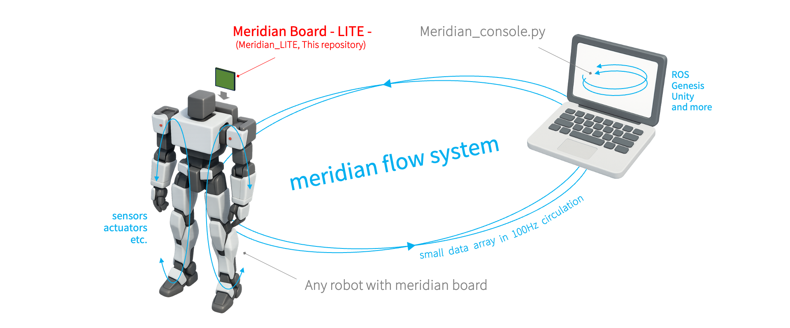

## Meridian とは

**Meridian**（meridian flow system）は、ロボットのリアルタイムなデジタルツインを実現するオープンソースのしくみです（2021 年〜）。

- ロボットと PC の間で、[**Meridim90**](https://ninagawa123.github.io/Meridian_info/#Protocol/Meridim90/overview90/) という 90 個の数値の配列を、100Hz でぐるぐる回し続けます。
- サーボの角度、センサーの値、リモコンのボタンなど、ロボットの状態はすべてこの配列に入ります。
- 中間に Meridim90 が入るので、メーカーの違うサーボやセンサー、Unity や ROS などの開発環境を、同じやりかたでつなげられます。

[](https://www.youtube.com/watch?v=4ymSV_Dot-U)

Meridian_LITE は、その ESP32（ESP32-DevKitC）版です。

## はじめかた（3 ステップ）

| | やること | 使うもの |
|:-:|---|---|
| **1** | 開発環境を入れる | セットアップスクリプト（ダブルクリック／1 コマンド） |
| **2** | 設定して ESP32 に書き込む | **Config Editor**（`meridian_config_editor.html`） |
| **3** | 通信を確かめる・ロボットを動かす | **Console**（`Meridian_console_lite.html`） |

エディタとコンソールはブラウザで開く画面です。**config.h を手で書き換えたり、VS Code を操作したりしなくても、まずは試せます。**
プログラムを書き換えて開発するときは、そのあとで [VS Code を使った開発](#vs-code-を使った開発) に進んでください。

<br><hr>

## 目次

- [準備するもの](#準備するもの)
- [1. インストール](#1-インストール)
- [2. テスト: ESP32 だけで通信を確かめる](#2-テスト-esp32-だけで通信を確かめる)
- [3. ロボットに載せる（KHR-3HV の例）](#3-ロボットに載せるkhr-3hv-の例)
- [Config Editor の使いかた](#config-editor-の使いかた)
- [Console の使いかた](#console-の使いかた)
- [VS Code を使った開発](#vs-code-を使った開発)
- [Unity・ROS・リモコン](#unityrosリモコン)
- [トラブルシューティング](#トラブルシューティング)
- [バージョン更新履歴](#バージョン更新履歴)

## 準備するもの

| もの | 備考 |
|---|---|
| [ESP32-DevKitC](https://www.espressif.com/en/products/devkits/esp32-devkitc/overview) | Espressif の正規品。WROOM-32E または WROVER-E |
| USB ケーブル | **データ通信できるもの**（充電専用では書き込めません） |
| PC | Windows 10 / 11、macOS、Ubuntu 22.04 / 24.04。WiFi 付き |
| WiFi | **2.4GHz** のアクセスポイント（ESP32 は 5GHz につながりません） |
| ブラウザ | [Google Chrome](https://www.google.com/chrome/) または Microsoft Edge（Safari・Firefox では保存と USB 書き込みが動きません） |

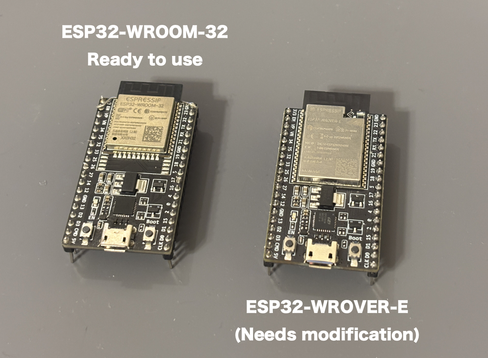

ロボットに載せるときは、さらに Meridian Board -LITE-、ロボット本体、電源が要ります（[3. ロボットに載せる](#3-ロボットに載せるkhr-3hv-の例)）。
電子工作は Arduino で L チカをしたことがあれば十分です。

<br><hr>

## 1. インストール

### ダウンロード

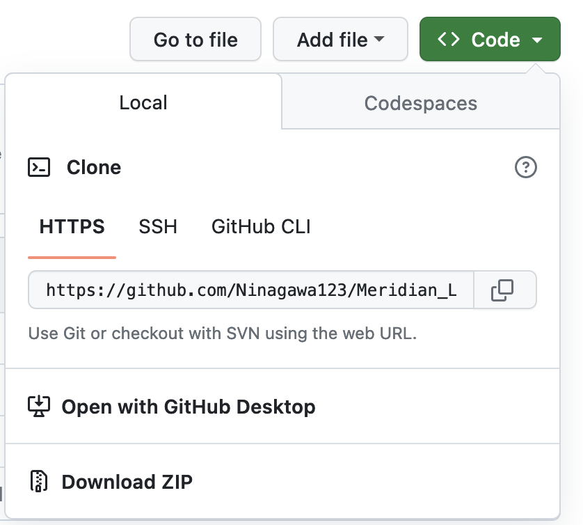

このページの **Code → Download ZIP** でダウンロードして展開します（`git clone` でもかまいません）。

> フォルダは、パスに日本語や空白を含まない場所に置くと安全です（例: `C:\Meridian\Meridian_LITE`、`~/Meridian_LITE`）。
> 中のファイルの位置関係は変えないでください。

### セットアップスクリプトを実行

OS に合うスクリプトを実行します。

| OS | 実行のしかた |
|---|---|
| **Windows 10 / 11** | `setup_windows.bat` をダブルクリック |
| **macOS** | ターミナルでフォルダに移動し `bash setup_mac.command` |
| **Ubuntu 22.04 / 24.04** | ターミナルでフォルダに移動し `bash setup_ubuntu.sh`（先に `sudo apt install zenity`） |

やることのチェックリストが出るので、そのまま **実行** を押せば大丈夫です。

- まだ済んでいない作業だけが選ばれた状態で出ます。何度実行しても安全です。
- 終わると、最後に VS Code でプロジェクトを開くか聞かれます。テストだけなら開かなくてもかまいません。

<details>
<summary>スクリプトがすること（一覧）</summary>

| 作業 | Windows | macOS | Ubuntu |
|---|:-:|:-:|:-:|
| VS Code・Python 3 を入れる（winget。ないときだけ） | ○ | | |
| コマンドライン・デベロッパツール（python3・git）を入れる | | ○ | |
| python3-venv を入れる【管理者】 | | | ○ |
| USB シリアルの権限（dialout グループ・udev ルール）【管理者】 | | | ○ |
| PlatformIO の場所を `C:\.platformio` にする（ユーザー名に日本語・空白があるときだけ） | ○ | | |
| VS Code に PlatformIO IDE 拡張を入れる | ○ | ○ | ○ |
| PlatformIO Core（ビルドの道具）を入れる | ○ | ○ | ○ |
| ESP32 のツールとライブラリを先にダウンロード（数分〜十数分） | ○ | ○ | ○ |
| `meridian-helper://` を登録（ブラウザの画面からビルドや通信ができるように） | ○ | ○ | ○ |
| ファイアウォールでコンソールの受信（UDP 22222）を許可【管理者】 | ○ | ○ | ○ |
| 既定のブラウザを Chrome / Edge にする | ○ | | ○ |
| 最後に VS Code でプロジェクトを開く | ○ | ○ | ○ |

- 実行の記録は、同じフォルダの `setup_windows.log` / `setup_mac.log` / `setup_ubuntu.log` に残ります。
- ESP32 用のツール（Espressif 32）は `platformio.ini` で決めた版が自動で入ります。手動で入れる必要はありません。

</details>

<details>
<summary>Windows の注意事項</summary>

- 「Windows によって PC が保護されました」と出たら、**詳細情報 → 実行** を押します。
- ファイアウォールの作業では確認画面（UAC）が出るので、「はい」を押します。
- ESP32 をつないだ状態で実行すると、USB シリアルのドライバがないときに知らせます。ボードに合うドライバを入れてください。
  - CP210x: https://www.silabs.com/developer-tools/usb-to-uart-bridge-vcp-drivers
  - CH340: https://www.wch-ic.com/downloads/CH341SER_EXE.html
- ユーザー名（`C:\Users\…`）に日本語や空白があると ESP32 のビルドに失敗することがあるので、スクリプトが PlatformIO の場所を `C:\.platformio` に変えます（ユーザー環境変数 `PLATFORMIO_CORE_DIR` と `.env`）。VS Code を開いていたら、一度閉じて開き直してください。
- 最後のまとめに、使える COM ポートが出ます。ESP32 をつないでいるのに出ないときは、ケーブルとドライバを確認してください。

</details>

<details>
<summary>macOS の注意事項</summary>

- `setup_mac.command` はダブルクリックでも動きますが、ダウンロードしたファイルは macOS に止められることがあります。そのときはターミナルで `bash setup_mac.command` を実行してください。
- チェックリストは ⌘ を押しながらクリックで複数選べます。
- `sudo` は付けずに実行してください。管理者の作業（ファイアウォール）のときだけパスワードを聞きます。ファイアウォールの作業は、macOS のファイアウォールが有効なときだけ出ます。
- コマンドライン・デベロッパツールを入れると、macOS のインストール画面が出ます。終わったら、スクリプトをもう一度実行して続きをします。
- ESP32 をつないでターミナルで `ls /dev/cu.*` を実行し、`/dev/cu.usbserial-…` や `/dev/cu.SLAB_USBtoUART` などが出れば USB は使えます。
- `meridian-helper://` は `~/Applications/Meridian Editor Helper.app` に登録されます。

</details>

<details>
<summary>Ubuntu の注意事項</summary>

- `sudo` は付けずに実行してください。管理者の作業は、まとめて 1 回だけパスワードを聞きます。
- Chrome と VS Code は .deb 版を使ってください。Firefox と Snap 版 Chromium では、エディタの保存と USB 書き込みが動きません。
- **dialout グループ**は、一度ログアウトしてログインし直すと有効になります。
- **udev ルール**を入れたときは、ESP32 の USB を一度抜いて挿し直してください。
- **brltty**（点字ディスプレイ用のソフト）が入っていると、ESP32 の USB を横取りすることがあります。点字ディスプレイを使っていなければ、スクリプトで外せます。
- ファイアウォール（ufw）が有効なときは、UDP 22222 の受信を許可する作業が出ます。

</details>

<details>
<summary>フォルダを移動したとき</summary>

`meridian-helper://` は、登録したときのフォルダを覚えています。フォルダを移動したり名前を変えたりしたときは、スクリプトをもう一度実行して「meridian-helper:// を登録」をやり直してください。

</details>

<br><hr>

## 2. テスト: ESP32 だけで通信を確かめる

まず ESP32-DevKitC だけ（サーボもボードもなし）で、PC と 100Hz で通信できるかを確かめます。
ESP32 はサーボの代わりに、**L 系統 0 番のサーボの値として ±30 度のサインカーブ** を返し続けます。

### ① エディタを開いて設定を読み込む

1. `meridian_config_editor.html` を Chrome（または Edge）で開きます（ダブルクリック、またはブラウザにドラッグ）。
2. 右上の **Load Config** を押し、`Meridian_LITE_for_ESP32/src/config.h` を選びます。
   - 「keys.h も読み込むか」と聞かれたら、`src` フォルダを選びます。次からは config.h と一緒に自動で読み込まれます。

### ② WiFi を設定する

**WiFi / LAN Settings** に入れます。

| 項目 | 入れる値 |
|---|---|
| SSID | WiFi（**2.4GHz**）の名前 |
| パスワード | WiFi のパスワード |
| PC の IP（`WIFI_SEND_IP`） | この PC の IP アドレス（`192.168.x.x` など） |

<details>
<summary>PC の IP アドレスの調べかた</summary>

- **Windows**: コマンドプロンプトで `ipconfig`
- **macOS**: システム設定 → ネットワーク → 使っている WiFi → 詳細
- **Ubuntu**: ターミナルで `ip -4 addr`

ESP32 と同じ WiFi につながっているものを選びます。

</details>

> WiFi のパスワードは `keys.h` に保存されます。`keys.h` は GitHub などに公開しないでください。

### ③ テスト用の設定にする

| 設定 | 値 |
|---|---|
| `MODE_ESP32_STANDALONE`（Operation Mode） | **1（オン）**: ボードに挿さずにテストする |
| `MOUNT_SD` / `MOUNT_IMUAHRS` / `MOUNT_PAD`（Hardware Mount） | `0` / `NO_IMU` / `PC` |

ほかはそのままでかまいません。**Save Config** を押して保存します（config.h と keys.h が保存されます）。

### ④ 書き込む

1. ESP32-DevKitC を USB で PC につなぎます。
2. 画面下の **Flash & Monitor** で、ボードの種類（`ESP32_DevKitC(WROOM-32E)` または `(WROVER-E)`）を選び、**Build & Write** を押します。
   - ブラウザが「Meridian Editor Helper を開きますか」と聞いたら、許可します（ビルドの手伝いをするプログラムが起動します）。
   - 書き込み先を聞かれたら、ESP32 のポートを選びます。
   - 初回のビルドは数分かかります。

<details>
<summary>書き込みがうまくいかないとき</summary>

- 何度かやり直すと成功することがあります。
- 書き込みが始まるときに ESP32 の **BOOT（または EN）ボタン** を押すとうまくいくことがあります。EN と GND の間に 10µF のコンデンサを入れると、ボタンなしで書き込めるようになることもあります。
- シリアルモニタなど、ほかのアプリがポートを使っていると書き込めません。閉じてからやり直してください。

</details>

### ⑤ ESP32 の IP アドレスを調べる

**WiFi / LAN Settings** の **ESP32 IP (Serial)** の **Read** を押します。ESP32 が USB 経由で再起動し、起動ログから IP アドレスを読み取ります。**Copy** でコピーしておきます。

<details>
<summary>起動ログを自分で見る場合</summary>

**Open Monitor** を押してから ESP32 の EN ボタンを押すと、起動ログが出ます。

```
WiFi successfully connected.
PC's IP address target => 192.168.xx.xx
ESP32's IP address => 192.168.xx.xx

-) Meridian -LITE- system on ESP32 now flows. (-
```

`ESP32's IP address` の番号が ESP32 の IP です。

</details>

### ⑥ コンソールでつなぐ

1. エディタ右上の **Open Console** を押します（`Meridian_console_lite.html` を直接開いてもかまいません）。
2. **Board IP** に ESP32 の IP を貼り付けて **Connect** を押します。
3. 画面下の **Message** の数が増え、**99〜100Hz** と出れば成功です。L 系統 0 番の値がサインカーブで動きます。

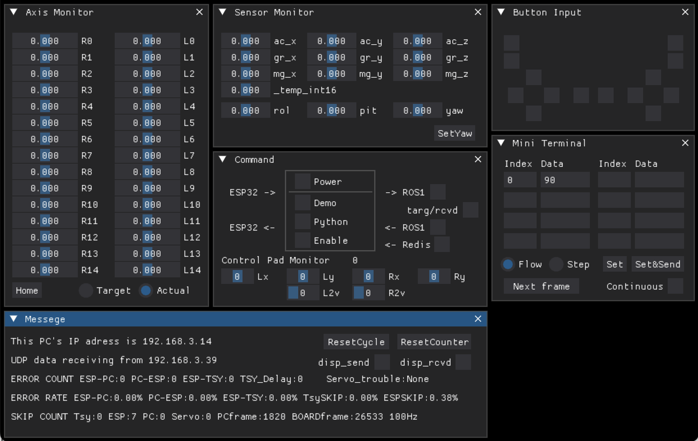

（画像は Python 版の [Meridian console](https://github.com/Ninagawa123/Meridian_console) です。ブラウザ版でも同じように値が動きます。Python 版もそのまま使えます。）

<details>
<summary>つながらないとき</summary>

- Connect した状態で、ESP32 を再起動してみてください。
- **Board IP** と、エディタの PC の IP（`WIFI_SEND_IP`）を確かめてください。PC の IP は、つなぐ WiFi が変わると変わります。
- 2.4GHz の WiFi につないでいるか確かめてください。
- PC のファイアウォールでコンソールの受信（UDP 22222）が許可されているか確かめてください。セットアップスクリプトの「ファイアウォール」で許可できます。

</details>

ここまでできれば、テストは完了です。

<br><hr>

## 3. ロボットに載せる（KHR-3HV の例）

近藤科学の二足ロボット **KHR-3HV** に Meridian Board -LITE- を載せる例です。

### Meridian Board -LITE-

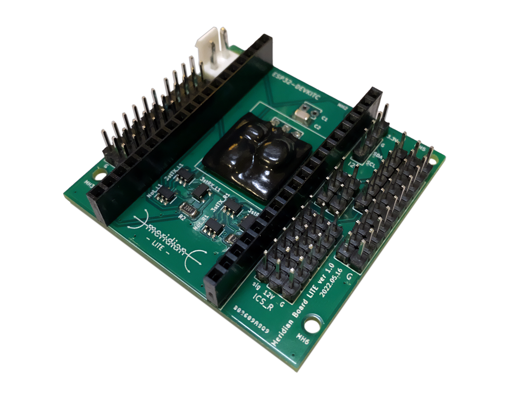

ESP32-DevKitC を載せて、サーボ（L・R の 2 系統）やセンサーをつなぐボードです。

- [回路図](https://github.com/Ninagawa123/Meridian_LITE/blob/main/docs/Meridian_Board_LITE_schema.pdf)を公開しているので自作できます。完成品の頒布もあります: https://1985b.booth.pm/
- より速く IO の多い [TWIN 版](https://github.com/Ninagawa123/Meridian_TWIN)もあります。

### 組み立て

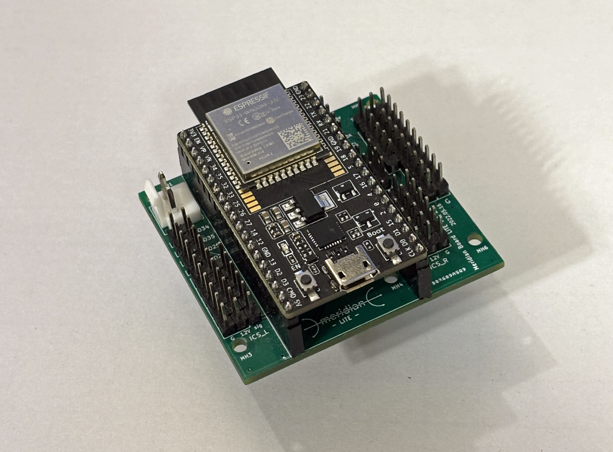 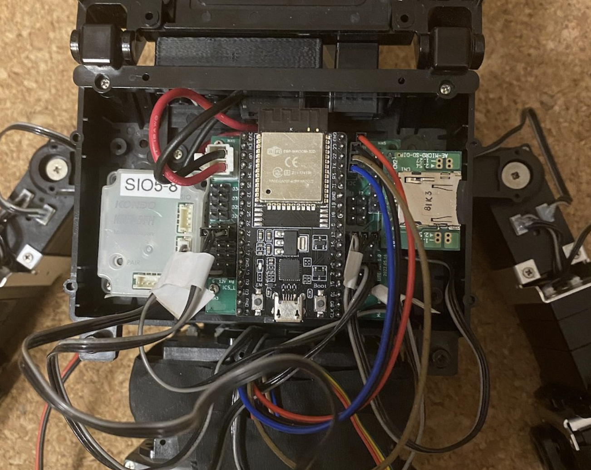

1. ESP32-DevKitC の USB コネクタが、ボードの Meridian -LITE- のロゴ側を向くように載せます。
2. KHR-3HV のランドセルに、本体無改造で固定できます（1〜2mm のスペーサーを挟むと、ボードの底面が当たりません）。
3. サーボを、**信号線（コネクタの羽）が内側を向くように** つなぎます。
4. 電源は、最初のテストではつながなくてかまいません（USB の 5V で動きます）。

> **注意**: サーボコネクタを逆に挿したり、ずらして挿したりすると、ボード上の IC が一発で壊れます。

<details>
<summary>ピンアサイン</summary>

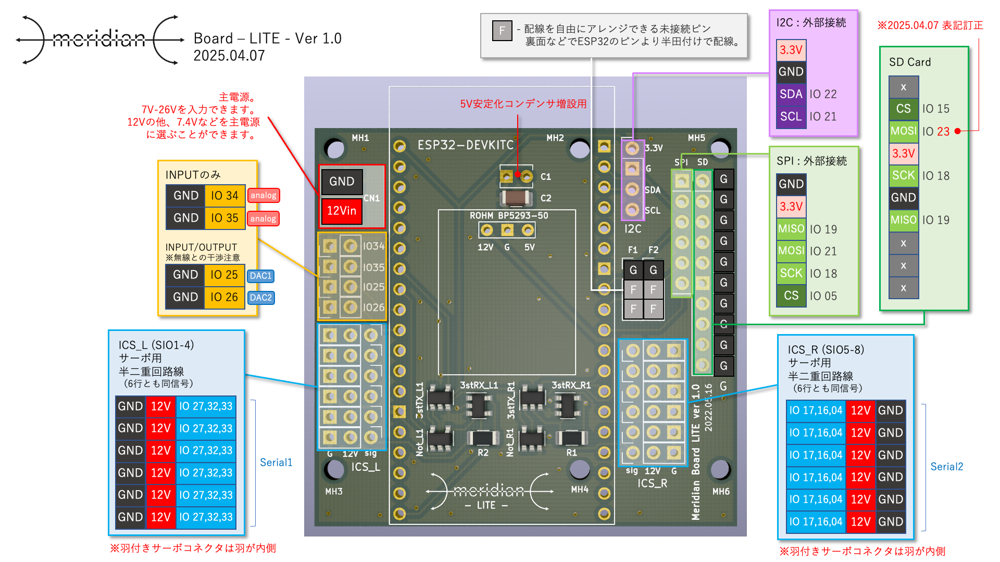

- IO が ESP32-DevKitC のピン番号です。
- SPI や SD カードを使わないときは、そのピンにほかの役割を与えることもできます。
- F は未接続のピンです。背面で好きな箇所と導線をはんだ付けして、自由に使えます。

</details>

<details>
<summary>周辺機器を足す</summary>

- **SD カード**: 秋月電子の SD カードホルダ [AE-MICRO-SD-DIP] を SPI 端子にそのままつなげます（ホルダ側にメスのピンヘッダを付けます）。
- **9 軸センサ**: 秋月電子の BNO055 [AE-BNO055-BO] を I2C につなぐのが標準です。
- **リモコン**: 受信機 KRR-5FH を内蔵できます。Wii リモコンにも対応しています（[リモコン](#unityrosリモコン)）。

</details>

### 設定して書き込む

1. エディタの **Preset** で `KHR_3HV` を選びます。KHR-3HV 向けの値がまとめて入ります。
2. 次の項目を、手元のロボットに合わせます。

   | 設定 | 値 |
   |---|---|
   | `MODE_ESP32_STANDALONE` | **0（オフ）**: ボードに挿してサーボを動かす |
   | `MRD_BOARD_SERVO_IF` | ボードの版。**1**: Ver L1.43 以上（SN74LXC1T45 版） / **0**: それより前 |
   | `MOUNT_SD` / `MOUNT_IMUAHRS` / `MOUNT_PAD` | 載せたものに合わせる（例: `0` / `BNO055_AHRS` / `KRR5FH`） |
   | L System / R System の表 | サーボをつないだ番号のマウント（`MT`）を 43（KRS サーボ）、つないでいない番号は 0 |

3. **Save Config** → **Build & Write** で書き込みます。
4. **Open Monitor** で次のように、つないだサーボの番号が出ていれば OK です。

   ```
   UART_L Servos mounted:  0  1  2  3  4  5  6  7  8  9 10
   UART_R Servos mounted:  0  1  2  3  4  5  6  7  8  9 10
   ```

### コンソールで確かめる

テストのときと同じようにコンソールでつなぎます。**99〜100Hz** と出れば成功です。
最初は全サーボがトルクオフです。関節を手で動かすと、コンソールのスライダーが動きます。

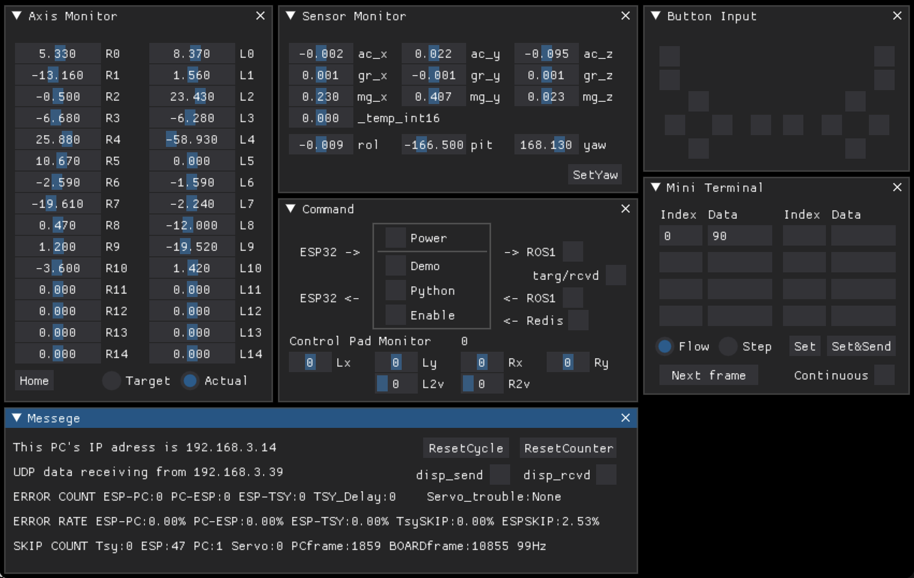

### トリム（原点）を合わせる

> **注意**: USB 給電だけで全サーボをオンにすると、電力不足になります。ボードに電源をつないでください。
> また、トリムが合っていないと、トルクを入れたときに関節が大きく動くことがあります。ロボットを吊るすなど、負荷のかからない状態で作業してください。

1. コンソールの **Trim** を押して、**Enter Trim Mode** を押します（サーボにトルクが入ります）。
2. 各サーボのスライダーや ± ボタンで、ロボットがまっすぐの姿勢になるように合わせます。回転方向・ID・マウントもこの画面で変えられます。
3. **Save to EEPROM** を押すと、ボードに保存されます。再起動しても、保存した値が使われます。
4. **Exit** で終わります。

### デモを動かす

[](https://www.youtube.com/watch?v=Wfc9j4Pmr3E)

コンソールの **Command** で **Power** にチェックを入れ、**Demo** にチェックを入れると、100Hz 更新のなめらかなダンスをします。

<details>
<summary>動作がおかしいとき</summary>

**100Hz にならない**
- WiFi ルーターが近くにあるか確かめてください。
- 応答しないサーボが 1 つでもあると、通信速度が大きく落ちます。マウントを左右 1 個ずつにして試してみてください。
- サーボケーブルや電源を確かめてください。
- Wii リモコンをつないだときも速度が落ちます（仕様です）。

**サーボの値がすごく暴れる**
- サーボケーブルが長すぎると通信が安定しません。

**L 系統か R 系統しか動かない**
- `MRD_BOARD_SERVO_IF`（ボードの版）が合っているか確かめてください（R 系統のピンが変わります）。
- 半二重回路が故障している可能性があります。

**一部のサーボが反応しない**
- サーボがファクトリーリセットなどで ID が 0 に変わったり、通信設定が変わったりすることがあります。ID が重なると、ほかのサーボまで誤動作します。
- エディタで該当するサーボのマウントを 0 にして再起動し、問題の箇所を探してください。

**数 % の通信エラーが出る**
- 1% 未満のエラーは仕様の範囲です（サーボとの通信は ESP32 の速度の限界ぎりぎりで動いており、ソフトウェアで補っています）。
- サーボへの電力不足、ESP32 の発熱（ヒートシンクや送風が効果的）、Wii リモコンの接続でもエラーが増えます。

**ESP32 がときどきリセットする**
- 電力不足が考えられます。ボードに十分な電力を供給してください。ESP32 の電源にコンデンサを足すのも効果があります。

</details>

<br><hr>

## Config Editor の使いかた

`meridian_config_editor.html` は、ファームウェアの設定ファイル（`src/config.h` と `src/keys.h`）を画面で編集し、そのままビルド・書き込みまでできるツールです。

| 場所 | できること |
|---|---|
| **Load Config / Save Config**（右上） | config.h（と keys.h）を読み込む / 保存する |
| **Preset**（右上） | ロボットごとの設定のまとまり。選ぶと値がまとめて入り、Save Config でいまの値が記録されます。**Add / Rename / Delete** で増やしたり消したりできます。WiFi の設定は config.h には入らず、keys.h にプリセットごとに保存されます |
| **Open Console**（右上） | コンソールを別のタブで開く |
| **Operation Mode** | 単体テスト、UDP の送受信などの動作モード |
| **Hardware Mount** | SD カード、IMU/AHRS、リモコンなど、載せたもの |
| **EEPROM Settings** | 起動時に EEPROM のどのページを使うか（`EEPROM_LOAD`）など。コンソールで保存したトリムを使うには **Servo slots**（P1）にチェックを入れます |
| **WiFi / LAN Settings** | 接続方式（WiFi-DHCP / 固定 IP / 有線 LAN）、SSID・パスワード・PC の IP（keys.h）。**ESP32 IP (Serial) → Read** で ESP32 の IP を読み取れます |
| **L System / R System** | サーボの表。番号ごとのマウント（種類）、ID、回転方向、トリムなど。**Copy L → R** で左右をそろえられます |
| **Flash & Monitor**（下） | ボードの種類を選んで **Build**（ビルドだけ）、**Build & Write**（ビルドして書き込み）、**Write Build to Board**（ビルド済みを書き込み）、**Open Monitor**（シリアルモニタ）、**Reset Board**（再起動） |

- Build や Read は、`meridian-helper://` から起動するヘルパー（`tools/editor_helper.py`）を通して動きます。
- 書き込みはブラウザの USB 機能（Web Serial）で行います。

<br><hr>

## Console の使いかた

`Meridian_console_lite.html` は、ESP32 と WiFi でつながり、Meridim90 の中身を見たり、ロボットに指令を送ったりするツールです。

| 場所 | できること |
|---|---|
| **Network / Board IP / Connect**（上） | 接続方式（WIFI(DHCP) / WIFI(Fixed) / Wired LAN）を選び、ESP32 の IP を入れてつなぐ |
| **Open Config Editor**（上） | エディタを別のタブで開く |
| **Axis Monitor** | 全サーボの角度。**Trim** でトリム画面、**Zero** で全サーボを 0 度（トリム込み）に |
| **Sensor Monitor** | IMU/AHRS の値。**Set Zero** でいまの姿勢を原点に、**Set Yaw** でヨーをリセット |
| **Command** | **Power**: サーボのトルクを入れる / **Enable**: PC で作った角度をロボットに送る / **Demo**: デモ動作（Enable も一緒にオン） |
| **Button Input / Control Pad Monitor** | リモコンのボタンの受信状況。画面のボタンから入力も送れます |
| **EEPROM** | ボードの EEPROM をページごとに読む（**Read**）、ファイルに保存（**Save to File**）、ファイルから書き込む（**Write from File**）、**Restart Board** で反映 |
| **Message** | 通信の回数と速度（Hz）、エラーの数。**ResetCounter** で数え直し |

<details>
<summary>Trim 画面のボタン</summary>

| ボタン | 動き |
|---|---|
| Enter Trim Mode | トリムモードに入る（サーボにトルクが入る） |
| Torque On / Off | 全サーボのトルクを入れる / 一度に脱力する |
| Raw Zero | トリムなしの 0 度に全サーボを動かす |
| Trim Zero | スライダーのトリムの位置に戻す |
| delta | ± ボタンで動かす量（度） |
| Save to EEPROM | トリム・回転方向・ID・マウントをボードに保存する |
| Export Settings / Show Setting Data | 設定を書き出す / 表示する（config.h に書き写すときに使います） |
| Exit | トリムモードを終わる |

</details>

<br><hr>

## VS Code を使った開発

ファームウェアのプログラムを書き換えるときは、VS Code と PlatformIO を使います（どちらもセットアップスクリプトで入ります）。

### プロジェクトを開く

1. VS Code の **ファイル → ファイルでワークスペースを開く** で `Meridian_LITE_for_ESP32/Meridian_LITE_for_ESP32.code-workspace` を開きます（セットアップスクリプトの最後の作業でも開けます）。
2. 「このフォルダ内のファイルの作成者を信頼しますか？」と出たら、信頼します。
3. 左端の PlatformIO（アリの顔）アイコンを押し、**PROJECT TASKS** の読み込みが終わるまで待ちます。

### ビルド・書き込み

| 操作 | やりかた |
|---|---|
| ビルド | 画面下の **✓**（PROJECT TASKS → esp32dev → Build） |
| 書き込み | 画面下の **→**（PROJECT TASKS → esp32dev → Upload） |
| シリアルモニタ | 画面下の **コンセント**（PROJECT TASKS → esp32dev → Monitor） |
| エディタ・コンソールを開く | PROJECT TASKS → esp32dev → Custom → **Open Config Editor** / **Open Console** |

WROVER-E のボードでは `esp32wrover` の方を使います。`====== [SUCCESS]` と出ればビルド成功です。

### 設定ファイル

設定はエディタでも VS Code でも変えられます。同じファイル（`src/config.h`・`src/keys.h`）を読み書きするので、行き来してもかまいません。

```c
// src/config.h（抜粋）
#define MOUNT_SD      0      // SDカードリーダーの有無 (0:なし, 1:あり)
#define MOUNT_IMUAHRS NO_IMU // IMU/AHRSの搭載 NO_IMU, MPU6050_IMU, MPU9250_IMU, BNO055_AHRS
#define MOUNT_PAD     PC     // ジョイパッドの搭載 PC, MERIMOTE, BLUERETRO, KRR5FH, WIIMOTE
#define MODE_ESP32_STANDALONE 1 // ESP32をボードに挿さず動作確認(0:NO, 1:YES)

// src/keys.h（抜粋）
#define WIFI_AP_SSID "xxxxxx"       // アクセスポイントのSSID(2.4GHz)
#define WIFI_AP_PASS "xxxxxx"       // アクセスポイントのパスワード
#define WIFI_SEND_IP "192.168.1.xx" // 送り先のPCのIPアドレス
```

- config.h の最後にある `/*MERIDIAN_…*/` のコメントは、エディタがプリセットを覚えておく場所です。手で書き換えないでください。
- `keys.h` と `.env`（PC ごとの設定。`.env.example` を参照）は公開しないでください。どちらも `.gitignore` で除外しています。

<details>
<summary>ファイル構造</summary>

```
Meridian_LITE/
├── setup_windows.bat / setup_mac.command / setup_ubuntu.sh   セットアップ
├── meridian_config_editor.html   設定エディタ
├── Meridian_console_lite.html    コンソール
├── vendor/                       エディタが使う書き込みライブラリ（esptool-js）
├── docs/EEPROM_LAYOUT.md         EEPROM の配置表
└── Meridian_LITE_for_ESP32/      ファームウェア（PlatformIO のプロジェクト）
    ├── platformio.ini
    ├── lib/
    │   ├── IcsClass_V210         KONDO サーボのライブラリ
    │   ├── ESP32Wiimote          Wii リモコンのライブラリ
    │   └── gs2d                  今後対応予定のサーボライブラリ
    ├── src/
    │   ├── config.h              Meridian の主な設定
    │   ├── keys.h                WiFi の SSID・パスワード・PC の IP
    │   ├── main.cpp / main.h     メインプログラム
    │   ├── mrd_command.h         マスターコマンド（トリム、EEPROM の読み書きなど）
    │   ├── mrd_eeprom.h          EEPROM
    │   ├── mrd_servo.h           サーボ処理
    │   ├── mrd_wifi.h / mrd_ether.h   WiFi / 有線 LAN
    │   ├── mrd_bt_pad.h          リモコン
    │   ├── mrd_sd.h / mrd_wire0.h     SD カード / I2C
    │   ├── mrd_move.h / mrd_disp.h / mrd_util.h   モーション / メッセージ / 細かい関数
    │   └── mrd_module/           サーボ制御（sv_ics.h など）、モーション（mv_*.h）
    └── tools/
        ├── editor_helper.py      ヘルパー（ビルド、UDP の中継）
        └── pio_config_tools.py   PlatformIO のタスク（Open Config Editor / Open Console）
```

</details>

<details>
<summary>フローチャート</summary>

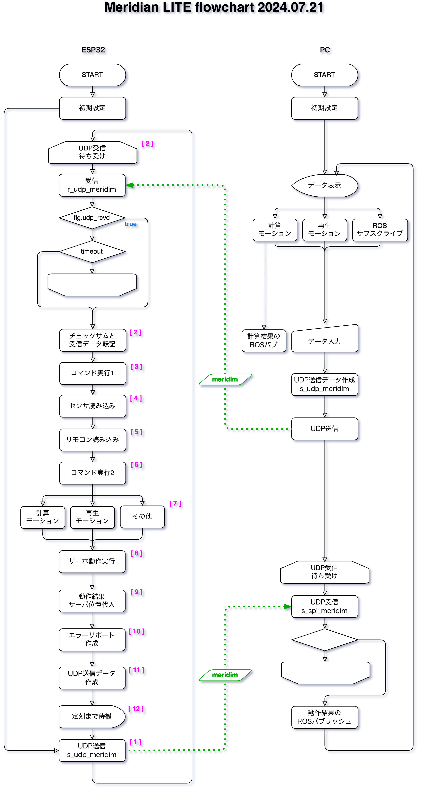

</details>

- コードの命名規則は LLVM 準拠です（`.clang-format` にコメントしています）。
- EEPROM のページの配置は [docs/EEPROM_LAYOUT.md](docs/EEPROM_LAYOUT.md) にあります。
- 関数や変数表など、システムの詳細: https://ninagawa123.github.io/Meridian_info/

<br><hr>

## Unity・ROS・リモコン

- **Unity**: [Meridian_Unity](https://github.com/Ninagawa123/Meridian_Unity/tree/main) で、ロボットと Unity をつなげられます。

  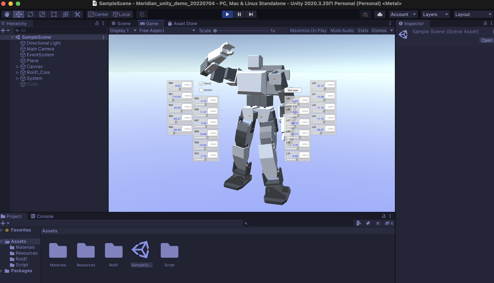

- **ROS**: [Meridian_TWIN](https://github.com/Ninagawa123/Meridian_TWIN/tree/main) の「ROS 版デモを実行する」をお試しください。
- **KRR-5FH / KRC-5FH**: エディタで `MOUNT_PAD` を `KRR5FH` にします。受信機はボードの **R 系統** につなぎます（R 系統が ICS サーボのときだけ）。ボタンの受信状況はコンソールで見られます。
- **Wii リモコン**（おまけ機能。通信速度が少し落ちます）: `MOUNT_PAD` を `WIIMOTE` にします。起動直後に 1・2 ボタンを同時に押すとペアリングします。ヌンチャクのレバーは左スティック、HOME ボタンはスティックのキャリブレーションです。

<br><hr>

## トラブルシューティング

<details>
<summary>セットアップスクリプトが動かない</summary>

- **Windows**: 「Windows によって PC が保護されました」と出たら **詳細情報 → 実行**。
- **macOS**: ダブルクリックで止められたら、ターミナルで `bash setup_mac.command`。
- **Ubuntu**: 「zenity がありません」と出たら `sudo apt install zenity`。
- スクリプトは `meridian_config_editor.html` と同じフォルダに置いたまま実行してください（`Meridian_LITE_for_ESP32 フォルダが見つかりません` と出るときは、置き場所が違います）。
- 何が起きたかは `setup_*.log` に残ります。

</details>

<details>
<summary>エディタの Build や コンソールの Connect が動かない</summary>

- セットアップスクリプトで「meridian-helper:// を登録」が「済」になっているか確かめてください。フォルダを移動したときは登録し直します。
- ブラウザが「Meridian Editor Helper を開きますか」と聞いたら許可してください。
- VS Code の PlatformIO の **Open Config Editor** / **Open Console** タスクから開くと、ヘルパーも一緒に起動します。

</details>

<details>
<summary>ビルドできない</summary>

- セットアップスクリプトの「PlatformIO Core を入れる」「ESP32 のツールとライブラリを先にダウンロード」が「済」か確かめてください。
- Windows でユーザー名に日本語・空白があるときは、スクリプトで PlatformIO の場所を `C:\.platformio` にしてください。
- `ESP32-WROVER cannot use GPIO16/17` と出るときは、下の「ESP32-WROVER-E を使う場合」を見てください。

</details>

<details>
<summary>ESP32 に書き込めない・ポートが出ない</summary>

- USB ケーブルがデータ通信できるものか確かめてください。
- USB シリアルのドライバ（CP210x / CH340）が入っているか確かめてください。
- Ubuntu では、dialout グループ（ログインし直しが必要）、udev ルール（USB の挿し直しが必要）、brltty を確かめてください。
- シリアルモニタなど、ほかのアプリがポートを使っていないか確かめてください。
- 書き込みの始めに BOOT（EN）ボタンを押す、EN と GND の間に 10µF のコンデンサを入れる、も試してください。

</details>

<details>
<summary>WiFi につながらない・コンソールにデータが来ない</summary>

- SSID とパスワードが正しいか、**2.4GHz** の WiFi か確かめてください。
- **Board IP** が ESP32 の IP（エディタの **ESP32 IP (Serial) → Read**）と同じか確かめてください。
- エディタの PC の IP（`WIFI_SEND_IP`）が、いまの PC の IP と同じか確かめてください。変わっていたら設定し直して書き込みます。
- PC と ESP32 が同じ WiFi につながっているか、ファイアウォールで UDP 22222 の受信が許可されているか確かめてください。

</details>

<details>
<summary>保存したトリムが再起動で戻る</summary>

- 起動ログの `Settings:` の行が `P1 servo=EEPROM` になっているか確かめてください。
- `P1 servo=config` のときは、エディタの **EEPROM Settings** の `EEPROM_LOAD` で **Servo slots**（P1）にチェックを入れ（`EEPROM_LOAD 2`）、Save Config して書き込み直します。そのあと、トリムを一度保存し直してください。

</details>

<details>
<summary>BNO055 のデータが取れない</summary>

I2C の通信がうまくいかないときは、写真のように 10kΩ 程度の抵抗でプルアップすると、よくなることがあります。

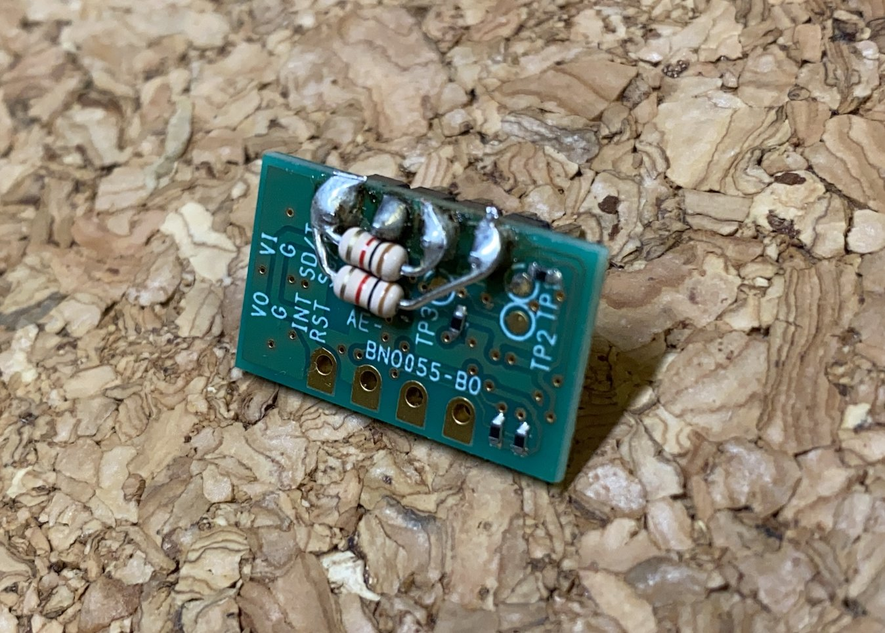

</details>

<details>
<summary>ESP32-WROVER-E を使う場合</summary>

ESP32-WROVER-E は、GPIO16・17 をモジュールの中で使っているため、ユーザーは使えません。

- **ボードが Ver L1.43 以上（`MRD_BOARD_SERVO_IF 1`）**: R 系統は GPIO14・13 を使うので、そのまま使えます。ボードの種類を **WROVER-E**（`esp32wrover`）にして書き込んでください。
- **それより前のボード（`MRD_BOARD_SERVO_IF 0`）**: R 系統が GPIO16・17 を使うため、WROVER-E では使えません（ビルドがエラーで止まります）。ESP32-WROOM-32E を使ってください。

</details>

<br><hr>

## バージョン更新履歴

### 2026.11 v1.1.2（hotfix）
- 設定エディタ（`meridian_config_editor.html`）とブラウザ版コンソール（`Meridian_console_lite.html`）を追加しました。設定、ビルド、書き込み、シリアルモニタ、通信の確認がブラウザでできます。
- Windows / macOS / Ubuntu のセットアップスクリプトを追加しました。
- EEPROM をページ単位で使うようにしました（`EEPROM_LOAD` でページごとに config と EEPROM を選べます。配置は [docs/EEPROM_LAYOUT.md](docs/EEPROM_LAYOUT.md)）。
- トリムモードを直しました。コンソールで保存したトリム・回転方向・ID・マウントを再起動後も使います。
- ESP32-WROVER-E 用のビルド（`esp32wrover`）を追加しました（L1.43 以上のボード）。
- 単体テストモードで、サーボの設定がなくても L 系統 0 番にサインカーブを返すようにしました。

<details>
<summary>それ以前の履歴</summary>

- **2026.04.26 v1.1.1**: Hotfix をマージ。
- **2025.06.14 v1.1.1**: WiFi 固定 IP、有線 LAN に対応。トリムモードに対応。
- **2024.08.18 v1.1.1**: コードをモジュールに分割し、Meridian_TWIN v1.1.0 と同等の構成に。命名規則を導入し、大規模なリファクタリング。
- **2024.08.19 v1.0.2**: v1.1.1 のリリースにあたり、旧版の最新版を v1.0.2 とした。
- **2023.09.15 v1.0.1**: ESP32 単体で通信テストができるモードを追加（L0 番に ±30 度のサインカーブ）。

</details>

## ライセンス

MIT License（[LICENSE](LICENSE)）。`vendor/esptool-js.js` と `Meridian_LITE_for_ESP32/lib/` の各ライブラリは、それぞれのライセンスに従います。
